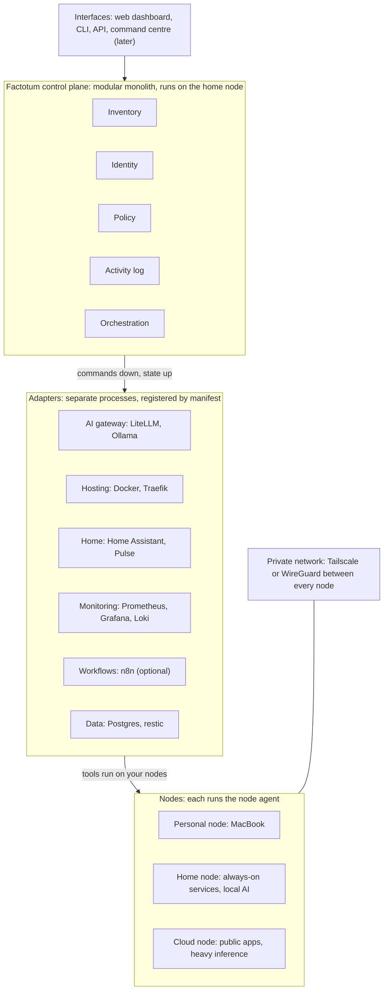

# Architecture overview

Factotum has three layers: a small control plane, adapters that translate to existing tools, and nodes that run those tools. Only the control plane is new software; the rest is what the owner already runs.

Commands flow down through adapters to each tool's own API, and state flows back up into the inventory and activity log. Nothing sits in the request path of managed apps, models or automations.

## Control plane

A modular monolith (NestJS) with one module per core concern: inventory, identity, policy, activity log, orchestration, plus supporting services for secrets, configuration and notifications. Modules have clear boundaries so one can be extracted later, but nothing requires microservices. Ownership rules are in [core-ownership.md](core-ownership.md).

## Integration tiers

Every capability starts at the lowest tier that is useful and moves up only when there is a reason.

| Tier | What Factotum does | Example |
| --- | --- | --- |
| 1. Link | Single sign-on and a launch tile; the tool's own UI is the UI | Grafana, n8n editor, Home Assistant |
| 2. Observe | Reads state through an adapter into the inventory and overview | Docker containers, Prometheus health, Ollama models |
| 3. Control | Sends commands through an adapter, under policy and audit | Restart a container, pull a model, run a backup |
| 4. Native | Factotum builds it, because no existing tool provides it | Inventory graph, policy engine, activity log, placement |

## Events and jobs

Factotum's own scheduling and retries use BullMQ. Events between modules and adapters are typed and versioned. Start with Postgres as the event store and BullMQ for delivery; add Redis Streams only when a second consumer needs ordered replay (ADR-005).

## Core data model sketch

| Entity | Key fields | Notes |
| --- | --- | --- |
| Principal | id, kind (person, automation, agent), role, budget | Every actor has one |
| Node | id, kind, capabilities, last heartbeat, privacy zone | Registered by the agent |
| Adapter | id, domain, tier, manifest version, health | Registered by manifest |
| Resource | id, kind, adapter, node, desired state, observed snapshot | Services, models, devices, containers |
| Policy | id, scope, rule, effect | Placement, privacy, action approval |
| Job | id, owner, placement, status, attempts | Run by the orchestration layer |
| Event | id, type, source, payload, time | Typed, versioned |
| Action run | id, action, principal, risk level, outcome | Written for every adapter call |
| Audit entry | id, who, what, where, when, outcome | Append-only |
| Secret reference | id, name, scope | Points to the store; never holds the value |

## Offline behaviour

With no internet, the dashboard, inventory, local models, home integrations and backups keep working. Cloud placements and cloud AI show as unavailable and queue or fail visibly.
