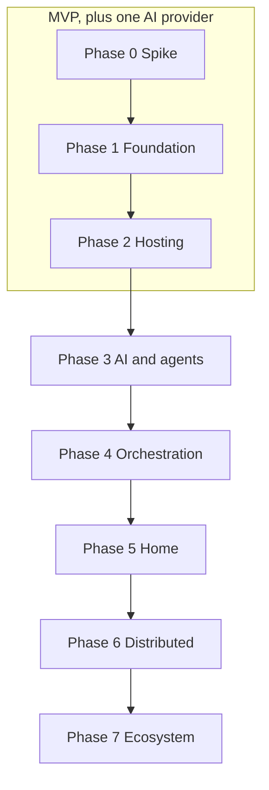

# Roadmap

Eight thin slices. Each ends with something you use and a gate you can test, so the project can stop after any phase and still be a working platform. Each gate becomes an acceptance test in that phase's backlog.

| Phase | Delivers | Exit gate |
| --- | --- | --- |
| 0. Spike | Node agent and control plane talk over the private network | A laptop agent heartbeats to the home server over Tailscale |
| 1. Foundation | Home server, API, login, dashboard shell, node registration, node metrics, activity log, backups | Log in from a phone, see node health; a backup restore test passes |
| 2. Hosting | Docker adapter, service registry, restart and deploy tracking, health alerts, action tiers, one AI provider | Restart and deploy a staging app from Factotum; an unhealthy service alerts you |
| 3. AI and agents | Ollama and LiteLLM adapters, routing policy with privacy classes, usage and cost, task submission | One task runs local and cloud; a private task is tested to never leave the home network |
| 4. Orchestration | Event bus, jobs, notifications, n8n link and triggers | An unhealthy service restarts and notifies you with no manual step |
| 5. Home | Home Assistant and Pulse adapters, device inventory, device events | Device state shows in the inventory; a home event starts an agent task |
| 6. Distributed | Second node, placement engine, remote runs, cloud resource view | Policy places a job on the cloud node; an offline node is handled without breaking privacy rules |
| 7. Ecosystem | Plugin install, third-party adapters, command centre | A new adapter installs with no core change; a command runs through the same policy layer |

## Notes on ordering

- **Phase 0 comes first** because the node agent and the adapter contract are the two components everything else depends on.
- **Hosting comes before AI** because the Docker adapter proves the adapter contract with the least risk.
- Domains that v0.1 left unscheduled are folded in where needed: backups and Postgres management in Phases 1 and 2, identity and private access in Phase 1, observability through the Monitoring adapter from Phase 1 onward.

## Rules for running the roadmap

- Do not start a phase before the previous gate passes on the real setup.
- A gate is a test, not an opinion. Write it as a script or checklist in the phase backlog.
- Changes to phase scope update this file, the backlog and, if significant, add an ADR.
